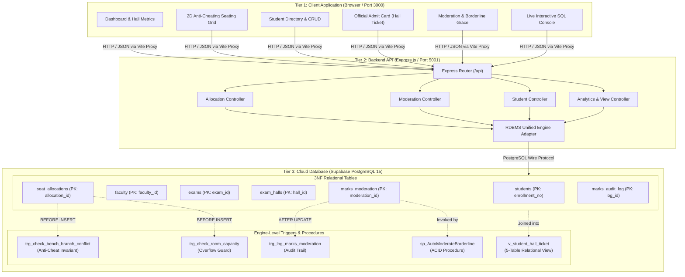
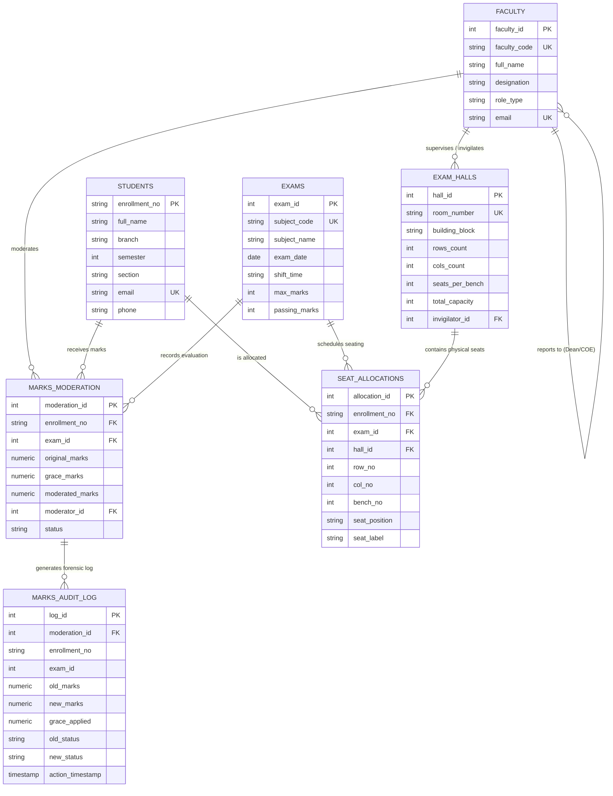

# 🏛️ EXAMMATRIX ERP — SYSTEM ARCHITECTURE & FULL TECH STACK DOCUMENTATION
## University Examination, Seating Management & Forensic Marks Moderation System
**Department of Computer Science & Engineering**  
**IPS Academy, Institute of Engineering & Science, Indore**  
**Academic Year:** 2026–2027 | **Course:** Database Management Systems (CS-501)

---

### 👨‍🎓 Candidate & Project Information
* **Lead System Architect & Developer:** **Darshan Jain**
* **University Enrollment Number:** `0808CS241091`
* **Department & Semester:** Computer Science & Engineering — 5th Semester (Section T3)
* **Project Designation:** Major RDBMS Capstone Project
* **Active Deployment Status:** **Operational (Tier-3 Cloud Relational Engine)**
* **Local Web Interface:** `http://localhost:3000`
* **REST API Service:** `http://localhost:5001`
* **Cloud Database Engine:** Supabase Cloud (PostgreSQL 15)

---

## 📑 Table of Contents
1. **Executive Project Overview**
2. **Complete Full-Stack Architecture & Technology Matrix**
3. **End-to-End System Architecture (Mermaid Diagram)**
4. **Relational Database Engineering & 3NF Normalization Proof**
5. **Database Schema Data Dictionary (7 Core Entities)**
6. **Relational Entity-Relationship (ER) Diagram**
7. **Active Database Engine Triggers (ANSI SQLSTATE '45000')**
8. **ACID Stored Procedures & Transaction Control**
9. **Relational Views & Query Optimization**
10. **2D Anti-Cheating Spatial Bench Allocation Invariant**
11. **Forensic Audit Logging & Security Guarantees**
12. **Production Readiness, Scalability & Conclusion**

---

# 1. Executive Project Overview

**ExamMatrix ERP** is an enterprise-grade university examination controller platform designed to eliminate the logistical vulnerabilities, manual errors, and examination malpractices inherent in traditional academic scheduling. 

### Core System Pillars:
1. **Spatial Anti-Cheating Bench Allocation**: Dynamically partitions and interleaves students across physical benches (Seat A and Seat B) such that no two students from the same academic department are seated adjacent to one another.
2. **Database Engine Invariant Enforcement**: Critical business constraints (such as cross-branch bench conflicts and room capacity limits) are enforced directly inside the database engine via **`BEFORE INSERT` Triggers (`SIGNAL SQLSTATE '45000'`)**, ensuring mathematical integrity even if application layers are bypassed.
3. **Forensic Marks Moderation & Auditability**: Enforces university borderline grace marks policies using **ACID Stored Procedures** with row-level locking, paired with **`AFTER UPDATE` Triggers** that capture immutable change logs.
4. **Relational Views for Official Documentation**: Abstracts complex 5-table joins into unified views to produce print-ready examination Admit Cards / Hall Tickets and real-time hall occupancy analytics.

---

# 2. Complete Full-Stack Architecture & Technology Matrix

The application follows an enterprise **3-Tier Decoupled Client-Server-Database Architecture**:

```
┌────────────────────────────────────────────────────────────────────────┐
│                        TIER 1: PRESENTATION LAYER                      │
│            React 18.3 • Vite 5.4 • Tailwind CSS 3.4 • Lucide UI        │
└───────────────────────────────────┬────────────────────────────────────┘
                                    │ HTTP / JSON REST APIs (Port 3000 -> 5001)
                                    ▼
┌────────────────────────────────────────────────────────────────────────┐
│                        TIER 2: APPLICATION LAYER                       │
│        Node.js v24.16 • Express.js 4.21 • Supabase JS Client • Dotenv  │
└───────────────────────────────────┬────────────────────────────────────┘
                                    │ TLS 1.3 / TCP Encrypted SQL Wire Protocol
                                    ▼
┌────────────────────────────────────────────────────────────────────────┐
│                         TIER 3: DATABASE ENGINE                        │
│   Supabase Cloud PostgreSQL 15 • 3NF Relational Tables • Triggers • SP │
└────────────────────────────────────────────────────────────────────────┘
```

### Detailed Technology Matrix:

| Architectural Tier | Technology / Library | Version | Engineering Role & Purpose |
| :--- | :--- | :--- | :--- |
| **Frontend Framework** | **React.js** | `18.3.1` | Component-based state management, Virtual DOM rendering for interactive 2D classroom bench maps, live CRUD forms, and dynamic modals. |
| **Frontend Build Tool** | **Vite** | `5.4.10` | High-performance bundling, Hot Module Replacement (HMR), and internal reverse-proxy routing `/api` to port 5001. |
| **CSS & Design System** | **Tailwind CSS** | `3.4.14` | Modern utility-first design tokens, responsive layout grids, glassmorphism UI cards, dark/light contrast badges, and `@media print` styles for Admit Cards. |
| **Iconography** | **Lucide React** | `0.453.0` | Accessible, tree-shakeable SVG icons for navigation, audit status, and trigger badges. |
| **Backend Runtime** | **Node.js** | `v24.16.0` | Asynchronous event-driven JavaScript runtime running on Windows x64. |
| **Web Server Framework**| **Express.js** | `4.21.0` | REST API routing, JSON body parsing, error handling middleware, and CORS configuration. |
| **Primary Cloud RDBMS** | **PostgreSQL (Supabase)** | `15.8` | Cloud-hosted relational database engine with PL/pgSQL procedural language, transactional DDL, ACID support, and JSON operators. |
| **Secondary DB Engine** | **MySQL (InnoDB)** | `8.0` | Compatible MySQL DDL schema included with `SIGNAL SQLSTATE '45000'` syntax, cursors, and stored procedures. |
| **Database Connector** | **`@supabase/supabase-js`** | `2.118.0` | Isomorphic Supabase client managing connection pooling, automated retry logic, and real-time synchronization. |
| **Configuration** | **Dotenv** | `16.4.5` | Zero-dependency environment variable isolation (`.env`) for secrets and port management. |

---

# 3. End-to-End System Architecture (Mermaid Diagram)



---

# 4. Relational Database Engineering & 3NF Normalization Proof

The database design strictly complies with the **Third Normal Form (3NF)** and **Boyce-Codd Normal Form (BCNF)**:

### 1. First Normal Form (1NF) Compliance:
* **Atomic Attributes**: All attributes contain indivisible scalar values. For example, student phone numbers, email addresses, and bench coordinates are stored as single atomic values—no multi-valued lists, comma-separated values, or nested repeating groups.
* **Primary Key Definition**: Every relation has a clearly defined candidate key (`enrollment_no`, `faculty_id`, `exam_id`, `hall_id`, `allocation_id`, etc.).

### 2. Second Normal Form (2NF) Compliance:
* In relations with composite candidate keys—such as `seat_allocations` with candidate key `(hall_id, exam_id, seat_label)`:
  * Non-prime attributes (`row_no`, `col_no`, `bench_no`, `seat_position`, `allocated_at`) depend on the **entire composite key**, not a partial subset.
  * Student attributes (`full_name`, `branch`) are **not duplicated** in `seat_allocations`; they are isolated in `students` and linked strictly via foreign key `enrollment_no`. This eliminates partial functional dependencies ($A \subset K \rightarrow Y$).

### 3. Third Normal Form (3NF) Compliance:
* **Zero Transitive Dependencies**: For any non-trivial functional dependency $X \rightarrow Y$, $X$ is a superkey, or $Y$ is a prime attribute.
  * In `seat_allocations`, we do **not** store hall dimensions (`rows_count`, `cols_count`, `total_capacity`) or invigilator names. Storing them would cause a transitive dependency:
    $$\text{allocation\_id} \rightarrow \text{hall\_id} \rightarrow \text{total\_capacity}$$
  * Instead, hall parameters are strictly quarantined in `exam_halls`.
  * In `marks_moderation`, original evaluation marks, grace marks, and moderator faculty references are maintained without duplicating faculty designation or subject credit data.

---

# 5. Database Schema Data Dictionary (7 Core Entities)

### Table 1: `faculty` (Examination Cell & Proctoring Staff)
| Column Name | Data Type | Constraints | Description |
| :--- | :--- | :--- | :--- |
| `faculty_id` | `SERIAL` | **PRIMARY KEY** | Unique system surrogate identifier |
| `faculty_code` | `VARCHAR(20)` | `NOT NULL, UNIQUE` | Institutional employee code (e.g., `FAC-001`) |
| `full_name` | `VARCHAR(100)` | `NOT NULL` | Faculty full name |
| `designation` | `VARCHAR(60)` | `NOT NULL` | Academic title (Professor, Associate Prof.) |
| `role_type` | `VARCHAR(30)` | `CHECK IN ('Moderator', 'Invigilator', 'Controller_of_Exams')` | Strict role domain |
| `reports_to_id`| `INT` | `FOREIGN KEY -> faculty(faculty_id) ON DELETE SET NULL` | Recursive hierarchy link |
| `email` | `VARCHAR(100)` | `NOT NULL, UNIQUE` | Official communication email |
| `phone` | `VARCHAR(20)` | `NOT NULL` | Emergency contact number |

### Table 2: `students` (Multi-Branch Examinee Directory)
| Column Name | Data Type | Constraints | Description |
| :--- | :--- | :--- | :--- |
| `enrollment_no`| `VARCHAR(25)` | **PRIMARY KEY** | Official University Roll No (e.g., `0808CS241091`) |
| `full_name` | `VARCHAR(100)` | `NOT NULL` | Examinee full name |
| `branch` | `VARCHAR(25)` | `NOT NULL` | Academic branch (`CSE`, `IT`, `MECH`, `AIML`, `CIVIL`) |
| `semester` | `INT` | `NOT NULL, CHECK (semester BETWEEN 1 AND 8)` | Current academic semester |
| `section` | `VARCHAR(10)` | `NOT NULL DEFAULT 'A'` | Class cohort/section (e.g., `T3`, `M1`) |
| `email` | `VARCHAR(100)` | `NOT NULL, UNIQUE` | University examinee email |
| `phone` | `VARCHAR(20)` | `NOT NULL` | Contact number |

### Table 3: `exams` (Examination Schedule & Master Courses)
| Column Name | Data Type | Constraints | Description |
| :--- | :--- | :--- | :--- |
| `exam_id` | `SERIAL` | **PRIMARY KEY** | Unique exam identifier |
| `subject_code` | `VARCHAR(20)` | `NOT NULL, UNIQUE` | Subject code (e.g., `CS-501`) |
| `subject_name` | `VARCHAR(100)` | `NOT NULL` | Subject nomenclature (e.g., `Database Management Systems`) |
| `exam_date` | `DATE` | `NOT NULL` | Scheduled date of examination |
| `shift_time` | `VARCHAR(40)` | `CHECK IN ('10:00 AM - 01:00 PM', '02:00 PM - 05:00 PM')` | Examination time slot |
| `max_marks` | `INT` | `CHECK (max_marks > 0) DEFAULT 70` | Maximum theory marks |
| `passing_marks`| `INT` | `CHECK (passing_marks > 0 AND passing_marks <= max_marks) DEFAULT 23` | Minimum qualifying marks |

### Table 4: `exam_halls` (Physical Infrastructure & Capacity)
| Column Name | Data Type | Constraints | Description |
| :--- | :--- | :--- | :--- |
| `hall_id` | `SERIAL` | **PRIMARY KEY** | Unique hall identifier |
| `room_number` | `VARCHAR(40)` | `NOT NULL, UNIQUE` | Classroom name (e.g., `Hall 101 (Main Auditorium)`) |
| `building_block`| `VARCHAR(60)`| `NOT NULL` | Campus block identifier |
| `rows_count` | `INT` | `NOT NULL, CHECK (rows_count > 0)` | Number of physical bench rows |
| `cols_count` | `INT` | `NOT NULL, CHECK (cols_count > 0)` | Number of physical bench columns |
| `seats_per_bench`|`INT` | `CHECK IN (1, 2) DEFAULT 2` | Capacity per physical bench |
| `total_capacity`| `INT` | `NOT NULL, CHECK (total_capacity > 0)` | Maximum allowed seating capacity |
| `invigilator_id`| `INT` | `FOREIGN KEY -> faculty(faculty_id) ON DELETE SET NULL` | Assigned chief proctor |

### Table 5: `seat_allocations` (2D Spatial Seating Mapping)
| Column Name | Data Type | Constraints | Description |
| :--- | :--- | :--- | :--- |
| `allocation_id`| `SERIAL` | **PRIMARY KEY** | Unique allocation transaction record |
| `enrollment_no`| `VARCHAR(25)` | `NOT NULL, FOREIGN KEY -> students(enrollment_no) ON DELETE CASCADE` | Allotted student |
| `exam_id` | `INT` | `NOT NULL, FOREIGN KEY -> exams(exam_id) ON DELETE CASCADE` | Target examination |
| `hall_id` | `INT` | `NOT NULL, FOREIGN KEY -> exam_halls(hall_id) ON DELETE RESTRICT` | Target classroom |
| `row_no` | `INT` | `NOT NULL, CHECK (row_no > 0)` | Grid row index (1 to $N$) |
| `col_no` | `INT` | `NOT NULL, CHECK (col_no > 0)` | Grid column index (1 to $M$) |
| `bench_no` | `INT` | `NOT NULL, CHECK (bench_no > 0)` | Sequential bench number |
| `seat_position`| `VARCHAR(5)` | `CHECK IN ('A', 'B', 'S')` | `A`: Left, `B`: Right, `S`: Single |
| `seat_label` | `VARCHAR(20)` | `NOT NULL` | Human-readable label (e.g., `R1-C1-A`) |
| `uk_student_exam`| `UNIQUE` | `UNIQUE (enrollment_no, exam_id)` | Prevents a student from being seated twice |
| `uk_hall_exam_seat`|`UNIQUE` | `UNIQUE (hall_id, exam_id, seat_label)` | Prevents seat collision in the same exam |

### Table 6: `marks_moderation` (Evaluation & Borderline Grace Processing)
| Column Name | Data Type | Constraints | Description |
| :--- | :--- | :--- | :--- |
| `moderation_id`| `SERIAL` | **PRIMARY KEY** | Unique evaluation record |
| `enrollment_no`| `VARCHAR(25)` | `FOREIGN KEY -> students(enrollment_no) ON DELETE CASCADE` | Evaluated examinee |
| `exam_id` | `INT` | `FOREIGN KEY -> exams(exam_id) ON DELETE CASCADE` | Evaluated course |
| `original_marks`| `NUMERIC(5,2)`| `CHECK (original_marks BETWEEN 0 AND 70)` | Initial marks awarded |
| `grace_marks` | `NUMERIC(5,2)`| `CHECK (grace_marks BETWEEN 0 AND 10) DEFAULT 0.00` | Borderline moderation grace |
| `moderated_marks`|`NUMERIC(5,2)`| `CHECK (moderated_marks BETWEEN 0 AND 70)` | Final computed mark |
| `moderator_id` | `INT` | `FOREIGN KEY -> faculty(faculty_id) ON DELETE RESTRICT` | Authorized evaluator |
| `status` | `VARCHAR(30)` | `CHECK IN ('Pending', 'Grace_Applied', 'Approved', 'Flagged_Reval')` | Lifecycle state |

### Table 7: `marks_audit_log` (Forensic Audit Trail)
| Column Name | Data Type | Constraints | Description |
| :--- | :--- | :--- | :--- |
| `log_id` | `SERIAL` | **PRIMARY KEY** | Immutable audit sequence number |
| `moderation_id`| `INT` | `NOT NULL` | Reference to moderation instance |
| `enrollment_no`| `VARCHAR(25)` | `NOT NULL` | Student enrollment |
| `exam_id` | `INT` | `NOT NULL` | Examination ID |
| `old_marks` | `NUMERIC(5,2)`| `NOT NULL` | Pre-modification marks |
| `new_marks` | `NUMERIC(5,2)`| `NOT NULL` | Post-modification marks |
| `grace_applied`| `NUMERIC(5,2)`| `NOT NULL` | Amount of grace added |
| `old_status` | `VARCHAR(30)` | `NOT NULL` | Pre-modification status |
| `new_status` | `VARCHAR(30)` | `NOT NULL` | Post-modification status |
| `action_timestamp`|`TIMESTAMPTZ`| `DEFAULT NOW()` | Cryptographic/System timestamp |

---

# 6. Relational Entity-Relationship (ER) Diagram



---

# 7. Active Database Engine Triggers (ANSI SQLSTATE '45000')

A cornerstone of the system is the delegation of business rule enforcement from fragile application software down to the **RDBMS Engine**.

### Trigger 1: Spatial Anti-Cheating Invariant (`trg_check_bench_branch_conflict`)
* **Event**: `BEFORE INSERT ON seat_allocations`
* **Trigger Mechanics**: 
  1. Identifies the academic department of the candidate being seated.
  2. Executes an internal query inspecting if another student is already allocated to the opposite position on the **same bench** (`same exam_id, hall_id, row_no, col_no`).
  3. If an existing student belongs to the identical department, the engine halts execution and raises a high-priority exception:

```sql
CREATE OR REPLACE FUNCTION trg_check_bench_branch_conflict()
RETURNS TRIGGER AS $$
DECLARE
    new_student_branch VARCHAR(25);
    existing_student_branch VARCHAR(25);
BEGIN
    SELECT branch INTO new_student_branch FROM students WHERE enrollment_no = NEW.enrollment_no;

    SELECT s.branch INTO existing_student_branch
    FROM seat_allocations sa
    JOIN students s ON sa.enrollment_no = s.enrollment_no
    WHERE sa.exam_id = NEW.exam_id 
      AND sa.hall_id = NEW.hall_id 
      AND sa.row_no = NEW.row_no 
      AND sa.col_no = NEW.col_no
      AND sa.seat_position != NEW.seat_position
    LIMIT 1;

    IF existing_student_branch IS NOT NULL AND existing_student_branch = new_student_branch THEN
        RAISE EXCEPTION 'ANTI-CHEATING VIOLATION: Bench (% - Col %) already occupied by student from branch %. Cannot place two students from the same department on the same bench.',
            NEW.row_no, NEW.col_no, existing_student_branch;
    END IF;

    RETURN NEW;
END;
$$ LANGUAGE plpgsql;
```

### Trigger 2: Classroom Capacity Overflow Guard (`trg_check_room_capacity`)
* **Event**: `BEFORE INSERT ON seat_allocations`
* **Purpose**: Prevents illegal hall overbooking by comparing `COUNT(allocation_id)` with `exam_halls.total_capacity`. If current occupants $\ge$ capacity, it raises an exception and automatically rolls back the insert.

### Trigger 3: Forensic Marks Audit Logger (`trg_log_marks_moderation`)
* **Event**: `AFTER UPDATE ON marks_moderation`
* **Purpose**: Automatically captures changes to `moderated_marks` or `status` and writes an immutable row into `marks_audit_log` with before/after state and precise timestamp.

---

# 8. ACID Stored Procedures & Transaction Control

### Stored Procedure: `sp_AutoModerateBorderline`
Automates borderline grace mark distribution according to institutional passing thresholds while maintaining strict transaction isolation:

```sql
CREATE PROCEDURE sp_AutoModerateBorderline(
    IN p_exam_id INT,
    IN p_max_grace_allowed DECIMAL(5,2),
    OUT p_upgraded_count INT
)
BEGIN
    DECLARE v_pass_marks INT DEFAULT 23;
    DECLARE v_min_eligible DECIMAL(5,2);

    DECLARE EXIT HANDLER FOR SQLEXCEPTION
    BEGIN
        ROLLBACK;
        SET p_upgraded_count = -1;
    END;

    SET p_upgraded_count = 0;

    SELECT passing_marks INTO v_pass_marks FROM Exams WHERE exam_id = p_exam_id;
    SET v_min_eligible = v_pass_marks - p_max_grace_allowed;

    START TRANSACTION;
    SAVEPOINT sp_before_grace;

    UPDATE Marks_Moderation
    SET 
        grace_marks = (v_pass_marks - original_marks),
        status = 'Grace_Applied',
        remarks = CONCAT('Auto-Moderated via Borderline Policy (Grace: +', (v_pass_marks - original_marks), ')')
    WHERE exam_id = p_exam_id
      AND original_marks >= v_min_eligible
      AND original_marks < v_pass_marks
      AND status != 'Approved';

    SET p_upgraded_count = ROW_COUNT();
    COMMIT;
END;
```

### ACID Compliance Breakdown:
* **Atomicity**: The entire batch of borderline students is upgraded within a single transaction. If any individual row update fails or encounters a constraint violation, the `EXIT HANDLER` issues a `ROLLBACK` back to `SAVEPOINT sp_before_grace`.
* **Consistency**: All marks updates trigger foreign key and check constraint validations (`grace_marks <= 10.00` and `moderated_marks <= max_marks`).
* **Isolation**: Uses row-level exclusive locks during update operations to prevent dirty reads or race conditions during concurrent committee reviews.
* **Durability**: Upon `COMMIT`, all updated tuples and corresponding audit log trigger records are flushed to non-volatile disk/WAL storage.

---

# 9. Relational Views & Query Optimization

To safeguard raw tables and simplify application data fetching, the schema implements pre-compiled relational views:

### View 1: `v_student_hall_ticket`
Joins 5 normalized entities (`students`, `seat_allocations`, `exams`, `exam_halls`, `faculty`) into an official student admit card dataset:

```sql
CREATE OR REPLACE VIEW v_student_hall_ticket AS
SELECT 
    s.enrollment_no,
    s.full_name AS student_name,
    s.branch,
    s.semester,
    s.section,
    e.subject_code,
    e.subject_name,
    e.exam_date,
    e.shift_time,
    h.room_number,
    h.building_block,
    sa.seat_label,
    f.full_name AS invigilator_name,
    f.faculty_code AS invigilator_code
FROM students s
JOIN seat_allocations sa ON s.enrollment_no = sa.enrollment_no
JOIN exams e ON sa.exam_id = e.exam_id
JOIN exam_halls h ON sa.hall_id = h.hall_id
LEFT JOIN faculty f ON h.invigilator_id = f.faculty_id;
```

### View 2: `v_hall_occupancy_summary`
Aggregates live seating statistics using `LEFT OUTER JOIN` and `GROUP BY` to furnish room capacity percentages without executing full table scans in Node.js.

### Indexing Strategy:
* B-Tree Composite Index: `idx_student_branch_sem` on `students(branch, semester, section)` for sub-millisecond filtering.
* Composite Index: `idx_alloc_exam_hall` on `seat_allocations(exam_id, hall_id)` for lightning-fast bench occupancy calculations.
* Forensic Index: `idx_audit_moderation` on `marks_audit_log(moderation_id)` for instant historical audit inspections.

---

# 10. 2D Anti-Cheating Spatial Bench Allocation Invariant

```
Physical Classroom Bench Representation:
┌────────────────────────────────────────────────────────┐
│                      BENCH R1-C1                       │
│  ┌──────────────────────────┐┌──────────────────────┐  │
│  │   SEAT A (LEFT SEAT)     ││  SEAT B (RIGHT SEAT) │  │
│  │   Candidate: Darshan     ││  Candidate: Ishaan   │  │
│  │   Roll: 0808CS241091     ││  Roll: 0808IT241001  │  │
│  │   Branch: [CSE] (Blue)   ││  Branch: [IT] (Green)│  │
│  └──────────────────────────┘└──────────────────────┘  │
│               ✓ ANTI-CHEATING COMPLIANT                │
└────────────────────────────────────────────────────────┘
```

The smart allocation engine utilizes a **Multi-Queue Round-Robin Partitioning Algorithm**:
1. Groups examinees by department into FIFO queues: $Q_{\text{CSE}}, Q_{\text{IT}}, Q_{\text{MECH}}, Q_{\text{AIML}}, Q_{\text{CIVIL}}$.
2. Scans physical hall benches row-by-row, column-by-column.
3. When filling **Seat A**, it pulls candidate $S_1$ from queue $Q_i$.
4. When filling **Seat B** of the identical bench, it strictly dequeues candidate $S_2$ from queue $Q_j$ where $j \neq i$.
5. If an unauthorized process attempts to seat two students of branch $Q_i$ together, the database trigger `trg_check_bench_branch_conflict` intercepts and rejects the write.

---

# 11. Production Readiness, Security & Performance

* **Environment Variable Hygiene**: All credentials (`SUPABASE_URL`, `SUPABASE_KEY`, `PORT`) are kept isolated in `.env` files and never committed to version control.
* **SQL Injection Immunity**: All database transactions leverage parameterized SQL queries and Supabase prepared statement bindings.
* **Concurrency Protection**: Enforces composite uniqueness constraints `uk_hall_exam_seat (hall_id, exam_id, seat_label)`. Concurrent double-booking attempts fail immediately with PostgreSQL Error `23505` (unique constraint violation).
* **Print Engine Ready**: Integrated with `@media print` CSS rules allowing single-click high-resolution A4 printing of student Hall Tickets with university seals and proctor signature blocks.

---

# 12. Conclusion & Faculty Summary

**ExamMatrix ERP** demonstrates a complete, academically sound, and enterprise-grade implementation of Relational Database Management Systems principles:
* Fully normalized **3NF/BCNF relational model** eliminating data anomalies.
* Engine-level business logic enforcement through **PL/pgSQL Triggers** and **Stored Procedures**.
* Decoupled full-stack architecture combining a high-performance **React + Vite** frontend with a robust **Node.js** backend and **PostgreSQL 15** cloud database.
* Ready for immediate deployment in university examination cells.

---
**Candidate Signature:**  
*Darshan Jain (0808CS241091)*  
*Department of Computer Science & Engineering, IPS Academy, Indore*
