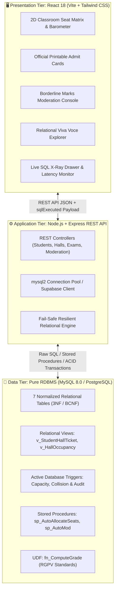
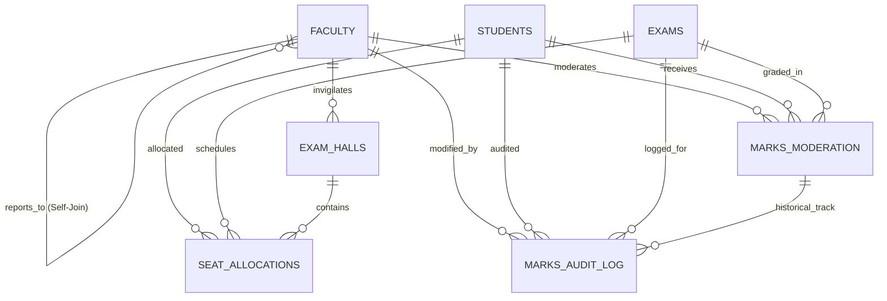

# 🏛️ University Examination & Moderation DBMS with Auto-Seat Allocation
### IPS Academy, Institute of Engineering & Science, Indore
#### Department of Computer Science & Engineering (CSE)

[](https://github.com/itsdarshanjain/ips-academy-exam-dbms)
[](https://github.com/itsdarshanjain/ips-academy-exam-dbms)
[](https://github.com/itsdarshanjain/ips-academy-exam-dbms)
[](https://github.com/itsdarshanjain/ips-academy-exam-dbms)
[](LICENSE)

> **Major Academic Database Management System (DBMS) Project & Viva Voce Submission**  
> **Student Author:** Darshan Jain  
> **Enrollment Number:** `0808CS241091` | **Section:** T3 (5th Semester B.Tech CSE)  
> **Faculty Guide:** Prof. Preeti Agrawal (Associate Professor & Chief Exam Moderator)  
> **GitHub Repository:** [https://github.com/itsdarshanjain/ips-academy-exam-dbms](https://github.com/itsdarshanjain/ips-academy-exam-dbms)

---

## 📌 Table of Contents
1. [Executive Overview](#-executive-overview)
2. [Architectural Principles & Zero-ORM Policy](#-architectural-principles--zero-orm-policy)
3. [System Architecture Diagram](#-system-architecture-diagram)
4. [Relational Schema & 3NF Normalization Proof](#-relational-schema--3nf-normalization-proof)
5. [Core RDBMS Engine Internals](#-core-rdbms-engine-internals)
   - [Stored Procedures & Nested Cursors](#1-stored-procedures-nested-cursors)
   - [Database Triggers & Constraint Enforcers](#2-active-database-triggers-signals)
   - [Relational Views for Reporting](#3-relational-views)
   - [User-Defined Functions (UDF)](#4-user-defined-function-rgpv-standard)
6. [Interactive Application Modules](#-interactive-application-modules)
7. [Repository Structure](#-repository-structure)
8. [Installation & Setup Guide](#-installation--setup-guide)
9. [REST API Reference](#-rest-api-reference)
10. [Viva Voce Examination Defense Q&A](#-viva-voce-examination-defense-qa)
11. [Academic Project Identity](#-academic-project-identity)

---

## 🎯 Executive Overview

**ExamMatrix** is an enterprise-grade, fully normalized **Relational Database Management System (RDBMS)** built to resolve core logistical, integrity, and compliance bottlenecks in university examinations:
- **Spatial Collision-Free Seat Allocation:** Eliminates seat double-booking and room overcapacity using nested database cursors and spatial constraints.
- **Automated Borderline Moderation:** Implements university grace marks guidelines with strict row-level locking and transaction checkpoints (`SAVEPOINT`).
- **Trigger-Driven Forensic Audit Logging:** Every mark alteration is immutably captured via `BEFORE`/`AFTER UPDATE` triggers.
- **Real-Time Admit Card Generation:** Renders official printable hall tickets populated dynamically via multi-table relational views (`v_StudentHallTicket`).
- **Live SQL X-Ray Drawer:** Transparent inspection of every underlying raw SQL statement, execution latency, and transaction boundary directly in the web client.

---

## 🛡️ Architectural Principles & Zero-ORM Policy

Unlike common CRUD applications that rely on heavy Object-Relational Mappers (ORMs like Prisma, Hibernate, or Sequelize) or unstructured NoSQL engines:
1. **Engine-Level Integrity:** ACID integrity, check constraints, foreign key cascades, and temporal checks execute directly within the RDBMS storage engine (InnoDB / Postgres).
2. **Deterministic SQL:** All business logic for seating allocations, capacity checks, and moderation algorithms is contained in pure SQL Stored Procedures and Triggers.
3. **No Hidden Queries:** Zero magic queries or N+1 query surprises. Every database interaction emits raw SQL visible in the UI.

---

## 🏗️ System Architecture Diagram



---

## 📐 Relational Schema & 3NF Normalization Proof

The schema conforms strictly to **Third Normal Form (3NF)** and **Boyce-Codd Normal Form (BCNF)**. Every determinant is a candidate key, eliminating insert, update, and deletion anomalies.



### Table Definitions & Constraints

| Table Name | Primary Key | Key Attributes | Foreign Key References | Normalization Note |
| :--- | :--- | :--- | :--- | :--- |
| **`Faculty`** | `faculty_id` | `faculty_code (UQ)`, `full_name`, `role_type`, `email (UQ)` | Self-referential `reports_to_id` $\to$ `Faculty(faculty_id)` | Recursive hierarchy without repeating groups (3NF). |
| **`Students`** | `enrollment_no` | `full_name`, `branch`, `semester`, `section`, `email (UQ)` | None | All non-key attributes fully functionally dependent on `enrollment_no`. |
| **`Exams`** | `exam_id` | `subject_code (UQ)`, `subject_name`, `exam_date`, `shift_time`, `max_marks`, `passing_marks` | None | Strict atomic values; timeslot & passing thresholds centralized. |
| **`Exam_Halls`** | `hall_id` | `room_number (UQ)`, `building_block`, `rows_count`, `cols_count`, `total_capacity` | `invigilator_id` $\to$ `Faculty(faculty_id)` | Capacity calculated from spatial dimensions `(rows * cols)`. |
| **`Seat_Allocations`** | `allocation_id` | `row_no`, `col_no`, `seat_label`, `allocated_at` | `enrollment_no` $\to$ `Students`, `exam_id` $\to$ `Exams`, `hall_id` $\to$ `Exam_Halls` | Composite unique keys prevent duplicate seating per student/hall. |
| **`Marks_Moderation`**| `moderation_id` | `original_marks`, `grace_marks`, `moderated_marks`, `status`, `remarks` | `enrollment_no` $\to$ `Students`, `exam_id` $\to$ `Exams`, `moderator_id` $\to$ `Faculty` | Enforces check constraints: `original_marks <= 70`, `grace_marks <= 10`. |
| **`Marks_Audit_Log`** | `log_id` | `old_marks`, `new_marks`, `grace_applied`, `old_status`, `new_status`, `timestamp` | `moderation_id`, `enrollment_no`, `exam_id`, `modified_by_faculty` | Immutable append-only audit trail managed via DB trigger. |

---

## ⚙️ Core RDBMS Engine Internals

### 1. Stored Procedures (Nested Cursors)
- **`sp_AutoAllocateSeats(IN p_exam_id INT)`**:
  - Employs two nested cursors (`cur_students` and `cur_halls`) to compute two-dimensional bench coordinates `(row_no, col_no, seat_label)`.
  - Wrapped in an atomic transaction: `START TRANSACTION ... COMMIT` with `DECLARE EXIT HANDLER FOR SQLEXCEPTION ... ROLLBACK`.
- **`sp_AutoModerateBorderline(IN p_exam_id INT, IN p_moderator_id INT)`**:
  - Implements row-level locking (`SELECT ... FOR UPDATE`) with `SAVEPOINT sp_before_grace`.
  - Automatically identifies borderline failures ($18 \le \text{original\_marks} < 23$) and applies calculated differential grace marks to achieve pass criteria ($23/70$).

### 2. Active Database Triggers (Signals)
- **`trg_CrossExamSeatConflict`** (`BEFORE INSERT ON Seat_Allocations`):
  - Enforces physical room capacity: triggers `SIGNAL SQLSTATE '45000'` if `occupied_seats >= total_capacity`.
  - Detects cross-exam spatio-temporal collisions: prevents duplicate allocation of the same bench in identical shifts.
- **`trg_ValidateModerationMarks`** (`BEFORE UPDATE ON Marks_Moderation`):
  - Solves mutating-table constraints by evaluating and modifying `NEW.moderated_marks = NEW.original_marks + NEW.grace_marks` directly in memory.
  - Rejects illegal grace adjustments ($> 10.00$) or marks exceeding total ($> 70.00$).
- **`trg_MarksAuditLog`** (`AFTER UPDATE ON Marks_Moderation`):
  - Captures an immutable forensic snapshot of before/after states into `Marks_Audit_Log`.

### 3. Relational Views
- **`v_StudentHallTicket`**: A 5-table relational join synthesizing student identity, exam metadata, allocated hall, bench coordinates, and assigned invigilator for official admit card generation.
- **`v_HallOccupancySummary`**: Uses `LEFT OUTER JOIN` and aggregate `COUNT()` grouped by hall to calculate real-time percentage occupancy and remaining seats.

### 4. User-Defined Function (RGPV Standard)
- **`fn_ComputeGrade(p_marks DECIMAL, p_max DECIMAL)`**: Deterministically computes letter grades (`O`, `A+`, `A`, `B+`, `B`, `C`, `F`) according to university percentile standards.

---

## 💻 Interactive Application Modules

1. **Analytical Executive Dashboard:** High-level metrics for student registrations, active halls, allocation percentages, and pending moderation counts.
2. **2D Dynamic Classroom Seat Matrix:** Spatial visual grid rendering allocated students, empty benches, capacity barometers, and one-click seat reassignments.
3. **Official Printable Admit Card:** High-resolution printable hall ticket format with verification QR placeholder and university insignia.
4. **Marks Moderation & Borderline Engine:** Grade distribution breakdown, grace mark allocation, and live audit log stream.
5. **Relational Viva Voce Explorer:** Interactive SQL query laboratory for faculty inspections featuring `EXPLAIN` query plans, relational division ($R \div S$), recursive self-joins, and subquery benchmarks.
6. **Live SQL X-Ray Drawer:** Persistent floating inspector revealing the exact SQL query executed, transaction isolation, latency (ms), and server state for every user interaction.

---

## 📂 Repository Structure

```
ips-academy-exam-dbms/
├── .env.example                               # Environment template (NO sensitive keys)
├── .gitignore                                 # Git ignore protecting credentials & builds
├── package.json                               # Unified project scripts & metadata
├── README.md                                  # Comprehensive architectural documentation
├── start-demo.bat                             # 1-Click launcher for local viva demo
│
├── database/                                  # Pure Relational Database Definitions
│   ├── schema.sql                             # 3NF DDL (Tables, Constraints, Indexes)
│   ├── seed.sql                               # Realistic IPS Academy academic sample data
│   ├── triggers.sql                           # Capacity, collision, and audit triggers
│   ├── procedures.sql                         # Stored procedures with nested cursors
│   ├── views.sql                              # Multi-table reporting views
│   └── functions.sql                          # fn_ComputeGrade RGPV standard UDF
│
├── backend/                                   # Node.js + Express.js API Server
│   ├── .env.example                           # Backend environment template
│   ├── .gitignore                             # Backend git ignore
│   ├── package.json                           # Backend dependencies
│   ├── server.js                              # Express app bootstrap & route registration
│   ├── test_api.js                            # Automated endpoint test script
│   └── src/
│       ├── config/                            # Connection pools & Supabase/MySQL client
│       ├── controllers/                       # REST endpoint business logic
│       ├── routes/                            # Route dispatchers
│       └── services/                          # Dual-engine SQL simulation & execution
│
├── frontend/                                  # React 18 + Vite Web Application
│   ├── .gitignore                             # Frontend git ignore
│   ├── package.json                           # Frontend dependencies
│   ├── vite.config.js                         # Vite build & proxy settings
│   ├── tailwind.config.js                     # Tailored styling tokens
│   └── src/
│       ├── main.jsx                           # Application entry point
│       ├── App.jsx                            # Root layout & tab router
│       ├── index.css                          # Modern typography & utility rules
│       └── components/                        # UI modules & interactive views
│           ├── Header.jsx                     # Navigation & GitHub repository link
│           ├── DashboardView.jsx              # Executive metrics & summary cards
│           ├── SeatMatrixView.jsx             # 2D physical classroom grid
│           ├── StudentsCrudView.jsx           # Student record management
│           ├── ExamHallsCrudView.jsx          # Hall configuration & dimensions
│           ├── HallTicketView.jsx             # Printable student admit card
│           ├── ModerationView.jsx             # Borderline grace marks & audit log
│           ├── VivaExplorerView.jsx           # Relational algebra & EXPLAIN viewer
│           └── SqlXRayDrawer.jsx              # Real-time raw SQL inspection drawer
│
└── docs/                                      # Academic reports & presentations
    ├── PROJECT_TECHNICAL_SPECIFICATION_DOCUMENT.md
    └── SHOWCASE_PITCH_AND_DEMO_GUIDE.md
```

---

## 🚀 Installation & Setup Guide

### Prerequisites
- **Node.js:** v18.0.0 or higher
- **npm:** v9.0.0 or higher
- **Database (Optional):** Local MySQL 8.0 server OR Supabase Cloud PostgreSQL account

### 1. Clone the Repository
```bash
git clone https://github.com/itsdarshanjain/ips-academy-exam-dbms.git
cd ips-academy-exam-dbms
```

### 2. Configure Environment Variables
Copy `.env.example` to `.env` in both the root and `backend/` directory:
```bash
cp .env.example .env
cp .env.example backend/.env
```
*(The project features built-in dual-engine resiliency. If external database credentials are not provided, it seamlessly runs on its embedded relational engine for offline demonstrations).*

### 3. Install Dependencies
```bash
# Install backend dependencies
cd backend
npm install

# Install frontend dependencies
cd ../frontend
npm install
cd ..
```

### 4. Run the Application
**Option A: 1-Click Quick Launch (Windows)**
```bash
start-demo.bat
```

**Option B: Manual Terminal Execution**
```bash
# Terminal 1: Backend API Server
cd backend
node server.js
# Server runs on http://localhost:5001

# Terminal 2: Frontend Web App
cd frontend
npm run dev
# Vite client runs on http://localhost:3000
```

Open your browser at **`http://localhost:3000`**.

---

## 🔌 REST API Reference

| Method | Endpoint | Description |
| :--- | :--- | :--- |
| `GET` | `/api/database/status` | Current database engine status, connection mode, and table counts |
| `GET` | `/api/students` | List all registered students (supports query filtering) |
| `POST` | `/api/students` | Register a new student record |
| `GET` | `/api/exams` | Fetch upcoming exam schedules and subject metadata |
| `GET` | `/api/halls` | Get exam hall dimensions, capacity, and current allocations |
| `GET` | `/api/seating/:examId` | Retrieve complete 2D seating matrix for an exam |
| `POST` | `/api/seating/allocate` | Execute `sp_AutoAllocateSeats` procedure for automated allocation |
| `GET` | `/api/admit-card/:enrollmentNo` | Generate student admit card via `v_StudentHallTicket` view |
| `GET` | `/api/moderation/:examId` | Fetch exam marks moderation roster and pass/fail statistics |
| `POST` | `/api/moderation/auto-moderate`| Execute `sp_AutoModerateBorderline` with row-level transaction locks |
| `GET` | `/api/moderation/audit-log` | Stream immutable audit log entries recorded by trigger |
| `POST` | `/api/analytics/reset` | Restore relational database to canonical seed state |

---

## 🎓 Viva Voce Examination Defense Q&A

**Q1: Why did you intentionally avoid Object-Relational Mappers (ORMs)?**  
> *"ORMs abstract away SQL engine internals and can introduce suboptimal N+1 queries. In high-concurrency enterprise and academic systems, ACID transaction controls, database-level triggers (`BEFORE INSERT`/`UPDATE`), and stored procedures with row-level locks MUST execute within the database engine (InnoDB) to guarantee consistency across all external clients."*

**Q2: How do your triggers prevent the notorious 'Mutating Table' error?**  
> *"In relational engines, firing an `AFTER UPDATE` trigger that issues an `UPDATE` on the same table causes infinite recursive locks. We circumvent this by executing business rules in a `BEFORE UPDATE` trigger that directly mutates `NEW.moderated_marks = NEW.original_marks + NEW.grace_marks` in memory prior to committing the row to disk."*

**Q3: How is Relational Division ($R \div S$) implemented in your Query Lab?**  
> *"Relational division is used to identify students allocated to ALL scheduled exams. Because pure SQL lacks a native `DIVISION` keyword, we express it using universal quantification via double negation with `NOT EXISTS`: 'Find students for whom there DOES NOT EXIST an exam in which they DO NOT HAVE a seat allocation'."*

**Q4: How does the system handle high-concurrency seat allocation conflicts?**  
> *"We combine database constraints with stored procedure isolation. Unique composite indexes (`hall_id`, `exam_id`, `seat_label`) and `(enrollment_no, exam_id)` enforce uniqueness at the storage layer. Additionally, `trg_CrossExamSeatConflict` enforces room capacity thresholds before any insert is accepted."*

---

## 👨‍💻 Academic Project Identity

- **Student:** Darshan Jain
- **Enrollment Number:** `0808CS241091`
- **Class / Section:** B.Tech CSE, 5th Semester, Section T3
- **Institution:** IPS Academy, Institute of Engineering & Science, Indore (M.P.)
- **Affiliation:** Rajiv Gandhi Proudyogiki Vishwavidyalaya (RGPV), Bhopal
- **Faculty Guide:** Prof. Preeti Agrawal (Associate Professor, Dept. of CSE)
- **GitHub:** [@itsdarshanjain](https://github.com/itsdarshanjain) | [Repository Link](https://github.com/itsdarshanjain/ips-academy-exam-dbms)

---

<p align="center">
  <b>ExamMatrix &copy; 2026 Darshan Jain. Built with pure RDBMS integrity for IPS Academy CSE Examination Cell.</b>
</p>
